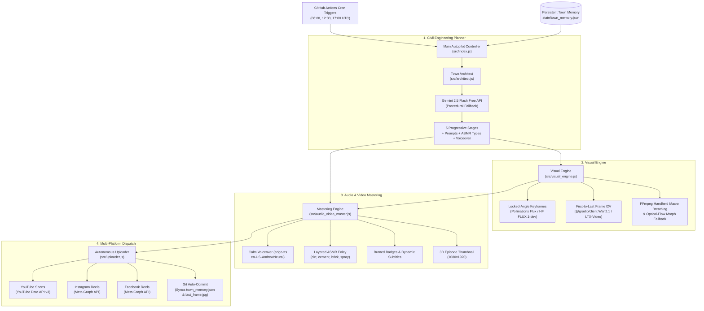

# Real Mini Township Autopilot 🏗️🎥

An autonomous, production-ready Node.js + GitHub Actions pipeline that designs, renders, and publishes 3 hyper-realistic vertical miniature construction reels (1080x1920) daily to **YouTube Shorts**, **Instagram Reels**, and **Facebook Reels**.

---

## 🌟 Visual Style & Diorama Continuity

Every video replicates the viral, highly satisfying miniature construction style:
- **Locked Macro Perspective**: The camera is fixed on a sturdy tripod at an extreme 45-degree isometric macro tilt-shift angle (`Sony A7RV 90mm f/2.8 lens`, razor-sharp center focus, soft creamy workbench bokeh).
- **Physical Craftsman Presence**: Real adult male craftsman hands (visible skin pores, slight cement/soil dust on knuckles, rolled-up dark denim sleeves, matte silver wristwatch) physically enter the frame holding miniature tools (mini steel trowel, precision tweezers, brass roller, micro airbrush, fine trimmers).
- **Continuous Diorama Memory**: The miniature town visibly grows step-by-step on the **exact same spot** across 5 sequential keyframes per episode. When yesterday's episode ends, its final frame (`state/last_frame_<town>.jpg`) and anchor description anchor the visual starting state of tomorrow's episode.

---

## 📅 The 3 Daily Series

| Series Key | Badge Tag & Color | Scheduled Cron (UTC) | IST Local Time | Starting State (Episode 1) |
|---|---|---|---|---|
| `mountain_village` | `VILLAGE • EP XX` (Green `#16a34a`) | `06:00 UTC` | 11:30 AM IST | Untouched alpine moss, jagged granite rocks & pine workbench |
| `smart_city` | `CITY • EP XX` (Blue `#2563eb`) | `12:00 UTC` | 05:30 PM IST | Virgin dark tabletop loam, wild weed sprouts & grid cutting mat |
| `desert_town` | `DESERT • EP XX` (Orange `#ea580c`) | `17:00 UTC` | 10:30 PM IST | Shifting red desert sand dunes, dry scrub & reclaimed oak bench |

---

## 🏛️ System Architecture



---

## 📁 Repository Structure

```
real-mini-township-autopilot/
├── .github/
│   └── workflows/
│       └── daily_towns.yml         # 3 Daily Cron Triggers + Manual Dispatch
├── state/
│   ├── town_memory.json            # Living memory of town builds & camera seeds
│   └── last_frame_*.jpg            # Saved final frame anchors for diorama continuity
├── src/
│   ├── index.js                    # End-to-end autonomous controller
│   ├── architect.js                # Gemini 2.5 Flash civil planning & prompts
│   ├── visual_engine.js            # Keyframes, Gradio I2V, and FFmpeg fallback
│   ├── audio_video_master.js       # AndrewNeural TTS, ASMR foley, badges & thumbnails
│   └── uploader.js                 # YouTube, Instagram, Facebook & Git sync
├── output/
│   ├── test_ep1.mp4                # Local test generation output video
│   └── test_ep1_thumb.jpg          # Local test 3D thumbnail output
├── test_local.js                   # Local one-command test generator (no uploads)
├── package.json                    # Node.js dependencies and script shortcuts
├── .env.example                    # Template for API credentials and secrets
└── README.md                       # Complete documentation
```

---

## 🚀 Quick Start (Local Testing)

You can generate **Episode 1** locally right away without uploading anything to inspect the video quality, visual continuity, ASMR audio, and top-left badges:

### 1. Install Dependencies
Ensure you have **Node.js (>=18)** and **FFmpeg** installed.

```bash
npm install
```

### 2. Run Local Inspection Test
Run the local test for `smart_city` (or `mountain_village` / `desert_town`):

```bash
# Generate Smart City Episode 1 locally:
node test_local.js smart_city

# Or run other series:
node test_local.js mountain_village
node test_local.js desert_town
```

### 3. Inspect Artifacts
The script compiles the full vertical reel in ~50 seconds:
- **Video**: `output/test_ep1.mp4` (1080x1920, 30fps H.264 + AAC audio)
- **Thumbnail**: `output/test_ep1_thumb.jpg` (with 3D episode badge and 2-word build title)

---

## 🔑 GitHub Actions & Environment Configuration

To enable 100% autonomous daily publishing, copy `.env.example` to `.env` or set the following in **GitHub Repository Settings -> Secrets and variables -> Actions**:

| Secret Name | Provider | Purpose |
|---|---|---|
| `GEMINI_API_KEY` | Google AI Studio | Free Gemini 2.5 Flash for progressive civil planning |
| `HF_TOKEN` | Hugging Face | Access to FLUX.1-dev and Wan2.1 / LTX-Video Spaces |
| `YOUTUBE_CLIENT_ID` | Google Cloud | YouTube Data API v3 OAuth Client ID |
| `YOUTUBE_CLIENT_SECRET` | Google Cloud | YouTube Data API v3 OAuth Client Secret |
| `YOUTUBE_REFRESH_TOKEN` | Google Cloud | OAuth Refresh Token for YouTube channel upload |
| `INSTAGRAM_ACCESS_TOKEN` | Meta Developers | User Access Token with `instagram_content_publish` |
| `INSTAGRAM_ACCOUNT_ID` | Meta Developers | Instagram Professional Account ID |
| `FACEBOOK_PAGE_ACCESS_TOKEN`| Meta Developers | Page Access Token for Reels publishing |
| `FACEBOOK_PAGE_ID` | Meta Developers | Facebook Page ID |

> [!NOTE]
> All credentials are fully optional for testing. If any token is missing or `DRY_RUN=true` is set, the system gracefully logs that upload is skipped and completes the full video assembly without error.

---

## 🛠️ Operational Commands

```bash
# Start autonomous run for a town (generates and uploads):
node src/index.js smart_city
node src/index.js mountain_village
node src/index.js desert_town

# Dry run (renders full video, skips upload):
DRY_RUN=true node src/index.js smart_city
```

---

## 📜 License

MIT License. Designed for fully autonomous, continuous miniature content creation.
